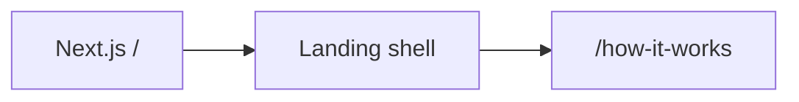

# Viral Remix: live operation

Operational reference for this Next.js app.  
Local dev: [README.md](../README.md). Session history: [JOURNAL.md](JOURNAL.md).

## Current state

| Item | Value |
|------|--------|
| Path | `c:\flutter_apps\viralremix` |
| Org / repo | unset (local git only) |
| Product | **Viral Remix**: take a video URL, recreate the format |
| Sister | Viral Radar (`c:\flutter_apps\viralradar`) — find outliers; this remakes one |
| Domain | unset |
| Stack | Next.js 16, React 19, Tailwind 4 |
| App root | `app/` (no `src/`) |
| Dev server | `npm run dev` or [`start.bat`](../start.bat) → **owner** verifies in browser. Agent never opens or fetches localhost. |
| Routes | `/`, `/how-it-works` |
| Backend | none yet |
| Production URL | unset |

### Git (this repo only)

| Setting | Value |
|---------|--------|
| Branch | `master` (create-next-app default) |
| `origin` | unset |

---

## Architecture

Landing shell only: hero video + grain + URL field. **Remix** does not submit. No Convex, no scrapers, no generation.



- **Home** ([`app/page.tsx`](../app/page.tsx)): video URL input, Remix disabled.
- **How it works** ([`app/how-it-works/page.tsx`](../app/how-it-works/page.tsx)): three stub steps.
- **Gitignore**: `.env*`, `node_modules/`, `.next/`, `.vercel/`.

---

## Environment variables

None required. Placeholders: [`.env.example`](../.env.example).

---

## Key files

| File | Role |
|------|------|
| [`app/page.tsx`](../app/page.tsx) | Landing |
| [`components/site-shell.tsx`](../components/site-shell.tsx) | Hero video + grain + header |
| [`lib/site-constants.ts`](../lib/site-constants.ts) | Hero loop URL |
| [`start.bat`](../start.bat) | `npm run dev` |

---

## Local testing

```bash
cd c:\flutter_apps\viralremix
npm run dev
npm run build
npm run lint
```

Owner verifies landing + `/how-it-works`. Agents do not fetch localhost.

---

## Deploy checklist

- [ ] Before push: `npm run build` locally
- [ ] Git remote
- [ ] Vercel (when ready)
