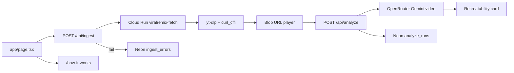

# Viral Remix: live operation

Operational reference for this Next.js app.  
Local dev: [README.md](../README.md). Session history: [JOURNAL.md](JOURNAL.md).

## Current state

| Item | Value |
|------|--------|
| Path | `c:\flutter_apps\viralremix` |
| Org / repo | [sid-kiwilab/viralremix](https://github.com/sid-kiwilab/viralremix) |
| Product | **Viral Remix**: take a video URL, recreate the format |
| Sister | Viral Radar (`c:\flutter_apps\viralradar`) — find outliers; this remakes one |
| Domain | unset |
| Stack | Next.js 16, React 19, Tailwind 4 |
| App root | `app/` (no `src/`) |
| Dev server | `npm run dev` or [`start.bat`](../start.bat) → **owner** verifies in browser. Agent never opens or fetches localhost. |
| Routes | `/`, `/how-it-works`, `/avatars`, `POST /api/ingest`, `POST /api/analyze` |
| Backend | Cloud Run `viralremix-fetch` (Docker + yt-dlp + curl_cffi + ffmpeg). Local Python only if `CLOUD_RUN_URL` is unset or whitespace. |
| Cloud Run revision | `viralremix-fetch-00003-4xt` (redeploy after `fetch_server.py` / Dockerfile changes) |
| GCP project | `viral-remix-app` (Firebase + Cloud Run) |
| Cloud Run region | `australia-southeast1` |
| Cloud Run URL | https://viralremix-fetch-898633406084.australia-southeast1.run.app |
| Production URL | unset (Next app still local) |

### Git (this repo only)

| Setting | Value |
|---------|--------|
| Branch | `main` |
| `origin` | `https://github.com/sid-kiwilab/viralremix.git` |

---

## Architecture

Landing + **Fetch** + **Analyze**: validate URL → Cloud Run downloads MP4 → Next streams bytes to the client → blob URL preview → auto **recreatability** analysis via OpenRouter (Gemini native video). Download failures → Neon `ingest_errors`. Each analyze attempt (success or fail, not client **499**) → Neon `analyze_runs` with `prompt_version`, full prompts, JSON result, tokens, latency. No MP4 stored in Neon.



- **Home** ([`app/page.tsx`](../app/page.tsx)): Instagram Reel / TikTok URL → ingest → `<video>` preview → auto analyze (prefer `loadedmetadata` for `durationSec`; **2.5s fallback** if metadata never fires). **Reading the format…** shows during `analyzePending` (pre-metadata) and in-flight analyze. Cancel (×) clears pending or aborts the request. Recreatability card in a **720px** analysis block below the player ([`components/recreatability-card.tsx`](../components/recreatability-card.tsx)): **Can drop**, **Remakes well**, **Hard to remake**.
- **Analyze** ([`app/api/analyze/route.ts`](../app/api/analyze/route.ts)): multipart MP4 (max **40MB**) → [`lib/openrouter.ts`](../lib/openrouter.ts) (`getConfiguredOpenRouterVideoModel`) + [`lib/recreatability.ts`](../lib/recreatability.ts) (**`PROMPT_VERSION` 2** — simplified remake plan, `canDrop`, segment-friendly duration). User prompt includes optional **`durationSec`** from the client; logged verbatim in `prompt_user`. Errors via [`lib/analyze-error.ts`](../lib/analyze-error.ts). Neon [`analyze-run-log`](../lib/analyze-run-log.ts): OpenRouter outcomes plus validation failures (**400**, **413** cap, bad MIME) when form metadata is available; not **499**. Timeout 90s; route `maxDuration` 120s; **504** upstream timeout. Instagram HD Reels often **25–35MB** / ~15s — use `analyze_runs` with `status = 413` to monitor the cap.
- **Ingest** ([`app/api/ingest/route.ts`](../app/api/ingest/route.ts)): [`parseSupportedVideoUrl`](../lib/video-url.ts), call Cloud Run (or local script), return `video/mp4` + `X-Video-*` headers. Forwards `request.signal` to upstream fetch / kills local Python on client disconnect; aborted requests return **499** (not logged to Neon).
- **Fetch worker** ([`scripts/fetch_server.py`](../scripts/fetch_server.py) + [`Dockerfile`](../Dockerfile)): same URL path rules as [`lib/video-url.ts`](../lib/video-url.ts), Bearer secret, MP4 or JSON error. Public URL (`--allow-unauthenticated`); no app-level rate limit yet — rely on secret + `max-instances`.
- **Ingest timeouts:** Shared [`INGEST_FETCH_TIMEOUT_MS`](../lib/ingest-constants.ts) = 290s on browser + upstream fetch. Cloud Run request timeout 300s; Next [`maxDuration`](../app/api/ingest/route.ts) 300s.
- **How it works** ([`app/how-it-works/page.tsx`](../app/how-it-works/page.tsx)): steps 1–2 live; step 3 Remix stub.
- **Avatars** ([`app/avatars/page.tsx`](../app/avatars/page.tsx)): **Luca** from [`lib/characters.ts`](../lib/characters.ts) — UI uses `profile-display.webp`; full assets under [`public/avatars/luca/`](../public/avatars/luca/) for future Remix (`generation.profile`, face, turnaround). Rebuild display file: [`scripts/optimize_avatar_display.py`](../scripts/optimize_avatar_display.py) (Pillow). Not wired to Remix.
- **Gitignore**: `.env*` (except example), `node_modules/`, `.next/`, `.vercel/`, legacy `/.data/`.

---

## Environment variables

| Variable | Required | Where | Notes |
|----------|----------|-------|--------|
| `CLOUD_RUN_URL` | For Cloud Run ingest | Next ingest route | Trimmed; empty/whitespace → local Python fallback |
| `FETCH_SERVICE_SECRET` | With `CLOUD_RUN_URL` | Next + Cloud Run env | Trimmed; required when Cloud Run URL is set |
| `NEON_CONNECTION_STRING` | For Neon logs | Next ingest + analyze | Trimmed; tables `ingest_errors`, `analyze_runs`; skips client aborts (499) on both routes |
| `PYTHON_PATH` | No | Local fallback only | Default `python` (Windows) or `python3` |
| `OPENROUTER_API_KEY` | For analyze | Next analyze route | Trimmed; server-only; Gemini via OpenRouter |
| `OPENROUTER_VIDEO_MODEL` | No | Next analyze route | Default **`google/gemini-2.5-flash`** (stable). Preview models (e.g. 3-flash) via env only when ready |
| `EVOLINK_API_KEY` | No | — | Documented for future Remix (generation); not used by analyze |

Placeholders: [`.env.example`](../.env.example). Never commit `.env`.

**Vercel note:** analyze uploads the session MP4 to the Next route (multipart). Serverless body limits may require moving analyze to Cloud Run when deploying; fine for local dev.

**Local fallback (only if `CLOUD_RUN_URL` is unset):** `pip install yt-dlp curl_cffi`

---

## Cloud Run fetch worker

GCP project: `viral-remix-app`  
Service: `viralremix-fetch`  
Account used to deploy: `kiwilabai@gmail.com`

```bash
gcloud services enable run.googleapis.com cloudbuild.googleapis.com artifactregistry.googleapis.com --project=viral-remix-app
gcloud run deploy viralremix-fetch --source . --project=viral-remix-app --region=australia-southeast1 --memory=2Gi --cpu=1 --timeout=300 --concurrency=2 --max-instances=3 --allow-unauthenticated --set-env-vars FETCH_SERVICE_SECRET=REPLACE
```

Do not put `.env` in the image (see [`.dockerignore`](../.dockerignore)).

**Redeploy** after changing the fetch worker (same command; bump revision on Cloud Run).

---

## Neon

### `ingest_errors`

Only failed downloads (after a valid Reel/TikTok URL). No success logging, no admin UI.

```sql
SELECT created_at, platform, url, raw_error, user_error
FROM ingest_errors
ORDER BY created_at DESC
LIMIT 20;
```

### `analyze_runs`

Versioned recreatability runs for a future results/history page. Bump [`PROMPT_VERSION`](../lib/recreatability.ts) when prompts change (current **2**). `prompt_user` is the per-run text from [`buildRecreatabilityUserPrompt`](../lib/recreatability.ts), not a fixed constant. Rows include `prompt_system`, `prompt_user`, `model`, `result` (jsonb, includes `canDrop` when ok), `overall_score`, `band`, `status`, `source_url`, `duration_sec`, `video_bytes`, `input_tokens`, `output_tokens`, `latency_ms`, `user_error`, `raw_error`. Failed rows include validation (**413** size cap) and OpenRouter failures. Client cancel (**499**) is not logged.

```sql
SELECT created_at, prompt_version, model, overall_score, band,
       duration_sec, input_tokens, output_tokens, latency_ms, source_url
FROM analyze_runs
ORDER BY created_at DESC
LIMIT 10;
```

Size-cap monitoring:

```sql
SELECT created_at, video_bytes, user_error, source_url, platform
FROM analyze_runs
WHERE status = 413
ORDER BY created_at DESC
LIMIT 20;
```

---

## Key files

| File | Role |
|------|------|
| [`app/page.tsx`](../app/page.tsx) | Landing + Fetch + analyze UI |
| [`app/api/ingest/route.ts`](../app/api/ingest/route.ts) | Ingest API |
| [`app/api/analyze/route.ts`](../app/api/analyze/route.ts) | Recreatability analyze API |
| [`lib/openrouter.ts`](../lib/openrouter.ts) | OpenRouter video chat |
| [`lib/recreatability.ts`](../lib/recreatability.ts) | Prompt v2, `buildRecreatabilityUserPrompt`, JSON parse (`canDrop`) |
| [`lib/analyze-constants.ts`](../lib/analyze-constants.ts) | Analyze timeout + size cap |
| [`lib/analyze-error.ts`](../lib/analyze-error.ts) | Sanitized analyze error copy |
| [`lib/analyze-run-log.ts`](../lib/analyze-run-log.ts) | Neon `analyze_runs` |
| [`components/recreatability-card.tsx`](../components/recreatability-card.tsx) | Score card (format read, dimensions, **Can drop** / remakes well / hard to remake; beats timeline or dotted list) |
| [`lib/ingest-error-log.ts`](../lib/ingest-error-log.ts) | Neon `ingest_errors` |
| [`lib/ingest-constants.ts`](../lib/ingest-constants.ts) | Shared ingest timeout (290s) |
| [`lib/video-url.ts`](../lib/video-url.ts) | URL allowlist / canonical URLs |
| [`scripts/fetch_video.py`](../scripts/fetch_video.py) | yt-dlp download |
| [`scripts/fetch_server.py`](../scripts/fetch_server.py) | Cloud Run HTTP wrapper |
| [`Dockerfile`](../Dockerfile) | Fetch worker image |
| [`components/logo-mark.tsx`](../components/logo-mark.tsx) | Header mark (orbital remix arc) |
| [`app/icon.svg`](../app/icon.svg) | Tab icon (remix arc on dark tile) |
| [`components/site-shell.tsx`](../components/site-shell.tsx) | Hero video + grain + header |
| [`app/avatars/page.tsx`](../app/avatars/page.tsx) | House avatars (Luca) |
| [`lib/characters.ts`](../lib/characters.ts) | Avatar catalog (`CHARACTERS`: role, consent, status, `profileSrc`, `generation.*`) |
| [`public/avatars/luca/`](../public/avatars/luca/) | Luca assets: `profile-display.webp` (UI), `profile.jpg` + `face.jpg` + `turnaround.jpg` (generation) |
| [`scripts/optimize_avatar_display.py`](../scripts/optimize_avatar_display.py) | Regenerate `profile-display.webp` after `profile.jpg` changes |
| [`start.bat`](../start.bat) | `npm run dev` |

---

## Local testing

```bash
cd c:\flutter_apps\viralremix
npm run dev
npm run build
npm run lint
```

Owner verifies: **Fetch** a public Reel or TikTok → recreatability card; cancel mid-analyze and **Read format again**; `/how-it-works`, `/avatars` (desktop + phone), tab icon. Restart dev server after adding `OPENROUTER_API_KEY`. Confirm rows in Neon `analyze_runs` after a successful analyze. Agents do not fetch localhost.

Failed downloads: Neon `ingest_errors` (`raw_error` is the yt-dlp/Cloud Run text).

---

## Deploy checklist

- [x] Before push: `npm run build` locally (last verified this session)
- [x] Git remote → GitHub `sid-kiwilab/viralremix`
- [x] Cloud Run fetch worker on `viral-remix-app` (`australia-southeast1`)
- [ ] Vercel — Next app only; set `CLOUD_RUN_URL`, `FETCH_SERVICE_SECRET`, `NEON_CONNECTION_STRING`, `OPENROUTER_API_KEY` (and plan for analyze body size)
