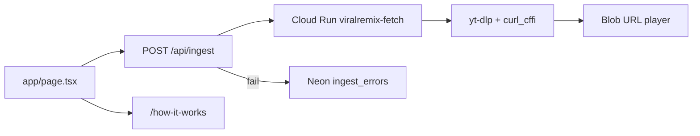

# Viral Remix: live operation

Operational reference for this Next.js app.  
Local dev: [README.md](../README.md). Session history: [JOURNAL.md](JOURNAL.md).

## Current state

| Item | Value |
|------|--------|
| Path | `c:\flutter_apps\viralremix` |
| Org / repo | [sid-kiwilab/viralremix](https://github.com/sid-kiwilab/viralremix) |
| Product | **Viral Remix**: take a video URL, recreate the format |
| Sister | Viral Radar (`c:\flutter_apps\viralradar`) — find outliers; this remakes one |
| Domain | unset |
| Stack | Next.js 16, React 19, Tailwind 4 |
| App root | `app/` (no `src/`) |
| Dev server | `npm run dev` or [`start.bat`](../start.bat) → **owner** verifies in browser. Agent never opens or fetches localhost. |
| Routes | `/`, `/how-it-works`, `POST /api/ingest` |
| Backend | Cloud Run `viralremix-fetch` (Docker + yt-dlp + curl_cffi + ffmpeg). Local Python only if `CLOUD_RUN_URL` is unset or whitespace. |
| Cloud Run revision | `viralremix-fetch-00003-4xt` (redeploy after `fetch_server.py` / Dockerfile changes) |
| GCP project | `viral-remix-app` (Firebase + Cloud Run) |
| Cloud Run region | `australia-southeast1` |
| Cloud Run URL | https://viralremix-fetch-898633406084.australia-southeast1.run.app |
| Production URL | unset (Next app still local) |

### Git (this repo only)

| Setting | Value |
|---------|--------|
| Branch | `main` |
| `origin` | `https://github.com/sid-kiwilab/viralremix.git` |

---

## Architecture

Landing + **Fetch**: validate URL → Cloud Run downloads MP4 → Next streams bytes to the client → blob URL preview. Download failures are sanitized for the browser and written to Neon `ingest_errors`.



- **Home** ([`app/page.tsx`](../app/page.tsx)): Instagram Reel / TikTok URL → ingest → `<video>` preview.
- **Ingest** ([`app/api/ingest/route.ts`](../app/api/ingest/route.ts)): [`parseSupportedVideoUrl`](../lib/video-url.ts), call Cloud Run (or local script), return `video/mp4` + `X-Video-*` headers. Forwards `request.signal` to upstream fetch / kills local Python on client disconnect; aborted requests return **499** (not logged to Neon).
- **Fetch worker** ([`scripts/fetch_server.py`](../scripts/fetch_server.py) + [`Dockerfile`](../Dockerfile)): same URL path rules as [`lib/video-url.ts`](../lib/video-url.ts), Bearer secret, MP4 or JSON error. Public URL (`--allow-unauthenticated`); no app-level rate limit yet — rely on secret + `max-instances`.
- **Ingest timeouts:** Shared [`INGEST_FETCH_TIMEOUT_MS`](../lib/ingest-constants.ts) = 290s on browser + upstream fetch. Cloud Run request timeout 300s; Next [`maxDuration`](../app/api/ingest/route.ts) 300s.
- **How it works** ([`app/how-it-works/page.tsx`](../app/how-it-works/page.tsx)): step 1 live; steps 2–3 stubs.
- **Gitignore**: `.env*` (except example), `node_modules/`, `.next/`, `.vercel/`, legacy `/.data/`.

---

## Environment variables

| Variable | Required | Where | Notes |
|----------|----------|-------|--------|
| `CLOUD_RUN_URL` | For Cloud Run ingest | Next ingest route | Trimmed; empty/whitespace → local Python fallback |
| `FETCH_SERVICE_SECRET` | With `CLOUD_RUN_URL` | Next + Cloud Run env | Trimmed; required when Cloud Run URL is set |
| `NEON_CONNECTION_STRING` | For error logs | Next ingest route | Trimmed; table `ingest_errors`; skips client aborts (499) |
| `PYTHON_PATH` | No | Local fallback only | Default `python` (Windows) or `python3` |

Placeholders: [`.env.example`](../.env.example). Never commit `.env`.

**Local fallback (only if `CLOUD_RUN_URL` is unset):** `pip install yt-dlp curl_cffi`

---

## Cloud Run fetch worker

GCP project: `viral-remix-app`  
Service: `viralremix-fetch`  
Account used to deploy: `kiwilabai@gmail.com`

```bash
gcloud services enable run.googleapis.com cloudbuild.googleapis.com artifactregistry.googleapis.com --project=viral-remix-app
gcloud run deploy viralremix-fetch --source . --project=viral-remix-app --region=australia-southeast1 --memory=2Gi --cpu=1 --timeout=300 --concurrency=2 --max-instances=3 --allow-unauthenticated --set-env-vars FETCH_SERVICE_SECRET=REPLACE
```

Do not put `.env` in the image (see [`.dockerignore`](../.dockerignore)).

**Redeploy** after changing the fetch worker (same command; bump revision on Cloud Run).

---

## Neon (`ingest_errors`)

Only failed downloads (after a valid Reel/TikTok URL). No success logging, no admin UI.

Example (Neon SQL editor):

```sql
SELECT created_at, platform, url, raw_error, user_error
FROM ingest_errors
ORDER BY created_at DESC
LIMIT 20;
```

---

## Key files

| File | Role |
|------|------|
| [`app/page.tsx`](../app/page.tsx) | Landing + Fetch + blob preview |
| [`app/api/ingest/route.ts`](../app/api/ingest/route.ts) | Ingest API |
| [`lib/ingest-error-log.ts`](../lib/ingest-error-log.ts) | Neon `ingest_errors` |
| [`lib/ingest-constants.ts`](../lib/ingest-constants.ts) | Shared ingest timeout (290s) |
| [`lib/video-url.ts`](../lib/video-url.ts) | URL allowlist / canonical URLs |
| [`scripts/fetch_video.py`](../scripts/fetch_video.py) | yt-dlp download |
| [`scripts/fetch_server.py`](../scripts/fetch_server.py) | Cloud Run HTTP wrapper |
| [`Dockerfile`](../Dockerfile) | Fetch worker image |
| [`components/logo-mark.tsx`](../components/logo-mark.tsx) | Header remix icon |
| [`app/icon.svg`](../app/icon.svg) | Tab icon |
| [`components/site-shell.tsx`](../components/site-shell.tsx) | Hero video + grain + header |
| [`start.bat`](../start.bat) | `npm run dev` |

---

## Local testing

```bash
cd c:\flutter_apps\viralremix
npm run dev
npm run build
npm run lint
```

Owner verifies: landing **Fetch** with a public Reel or TikTok, `/how-it-works`, tab icon. Agents do not fetch localhost.

Failed downloads: Neon table `ingest_errors` (`raw_error` is the yt-dlp/Cloud Run text).

---

## Deploy checklist

- [x] Before push: `npm run build` locally (last verified this session)
- [x] Git remote → GitHub `sid-kiwilab/viralremix`
- [x] Cloud Run fetch worker on `viral-remix-app` (`australia-southeast1`)
- [ ] Vercel — Next app only; set `CLOUD_RUN_URL`, `FETCH_SERVICE_SECRET`, `NEON_CONNECTION_STRING`
